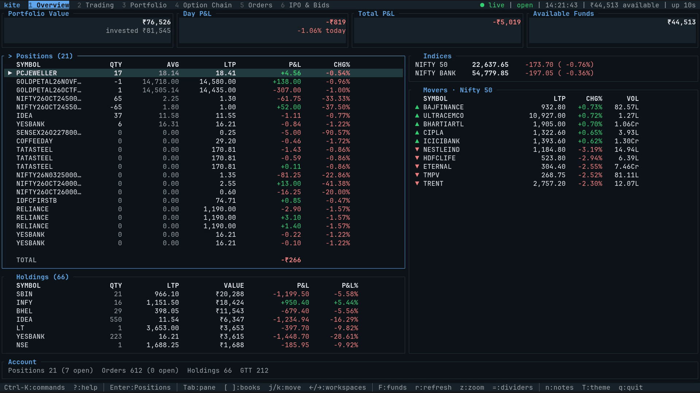

# Kite CLI

The official command-line interface and full-screen terminal workspace for [Zerodha Kite](https://kite.zerodha.com). Monitor live market data, analyse charts and option chains, manage your portfolio, and place orders directly from your terminal or shell scripts.

[Releases](https://github.com/zerodha/kite-cli/releases) · [Installation](docs/INSTALL.md) · [User Guide](docs/guide/README.md) · [CLI Reference](docs/CLI_REFERENCE.md) · [Screenshots](docs/SCREENSHOTS.md)



## Features

- **Live market data** — Stream real-time quotes, indices, 5-level market depth, and top market movers across your Kite watchlists or custom instrument lists.
- **Order execution & safety** — Place, modify, and cancel orders, GTT triggers, and price alerts (including alert-to-order baskets). Trading commands preview requests before submission unless `--confirm` is passed.
- **Portfolio & funds** — Track holdings, net and day positions, real-time profit and loss, and available margins.
- **Charts & technicals** — Read interactive candlestick charts with volume, multiple intervals, and built-in overlays and indicators (SMA, EMA, Bollinger Bands, RSI, MACD).
- **Derivatives & option chains** — Inspect live option chains with open interest, expiry selection, and a side-by-side chart of the underlying instrument.
- **Long-term investing** — View mutual fund holdings and SIPs, open IPOs, government securities, auctions, and corporate actions.
- **Six customizable workspaces** — Switch workspaces with `1`–`6`, resize or maximise panes, search instruments via the command palette, keep local trading notes, and choose from 22 built-in themes with live preview (`T`).
- **Scriptable CLI** — Query quotes, historical candles, orders, and portfolio data from standard UNIX pipelines with structured `--json` output.

## Installation

Install the prebuilt binary on **Linux** and **macOS** (`x86_64` and `aarch64` / Apple Silicon):

```sh
curl -fsSL https://raw.githubusercontent.com/zerodha/kite-cli/main/scripts/install.sh | sh
```

The installer detects your platform and verifies the archive's SHA-256 checksum before extracting `kite`.

Install on **Windows x86_64** with PowerShell:

```powershell
irm https://raw.githubusercontent.com/zerodha/kite-cli/main/scripts/install.ps1 | iex
```

See [Installation](docs/INSTALL.md) for manual archive downloads, custom install paths (`KITE_INSTALL_DIR`), and verification details.

## Quickstart

**1. Sign in to your Kite account**

```sh
kite auth login
```

Enter your Kite user ID, password, and 2FA code when prompted. Run `kite doctor` at any time to verify your setup and active session.

**2. Launch the terminal workspace**

```sh
kite
```

Press `?` inside the UI to view keyboard shortcuts, `1`–`6` to switch workspaces, or `T` to change themes.

**3. Or run CLI commands directly**

```sh
kite portfolio holdings        # Holdings and overall P&L
kite portfolio positions       # Net and day positions
kite orders list               # Today's order book
kite user margins              # Available and utilised funds
kite alerts list               # Active price alerts
kite market quote NSE:INFY     # Live quote and market depth
```

Pass `--json` to any command for machine-readable output in scripts and pipelines, or `--help` to inspect available flags. See [Orders](docs/guide/orders.md) and [Scripting](docs/guide/scripting.md) for examples.

## Documentation

| Guide | Description |
| :--- | :--- |
| [Getting started](docs/guide/getting-started.md) | First-time setup, login, session checks, and basic workflows |
| [Terminal UI guide](docs/guide/tui.md) | Workspaces, watchlists, order tickets, charts, and keybindings |
| [User guide](docs/guide/README.md) | Detailed guides for orders, portfolio, market data, alerts, and mutual funds |
| [CLI reference](docs/CLI_REFERENCE.md) | Complete reference for all commands, subcommands, and flags |
| [Screenshots](docs/SCREENSHOTS.md) | Full-resolution captures of all six workspaces and the theme picker |
| [Troubleshooting](docs/guide/troubleshooting.md) | Solutions for session errors, rate limits, and terminal display issues |

## Rust Client & Development

This repository also contains [`zerodha-kiteconnect`](crates/kiteconnect/README.md), a standalone typed Rust client for the [Kite Connect v3 REST and WebSocket API](https://kite.trade/docs/connect/v3/).

To build `kite` from source, run the test suite, or contribute changes, see [CONTRIBUTING.md](CONTRIBUTING.md).

## License

Licensed under the [MIT License](LICENSE).
