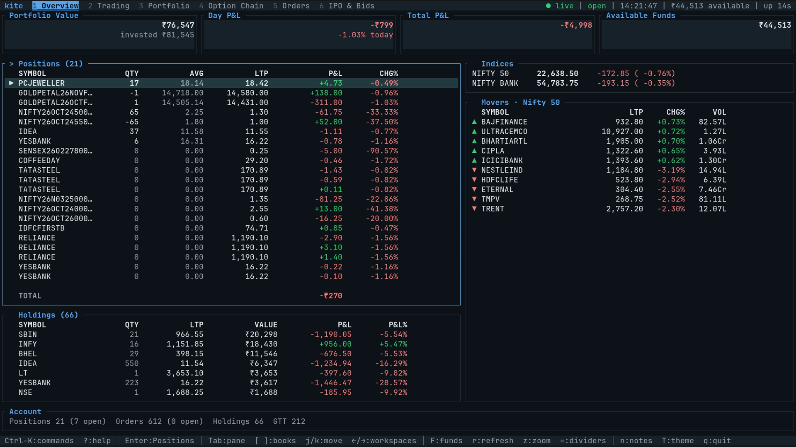
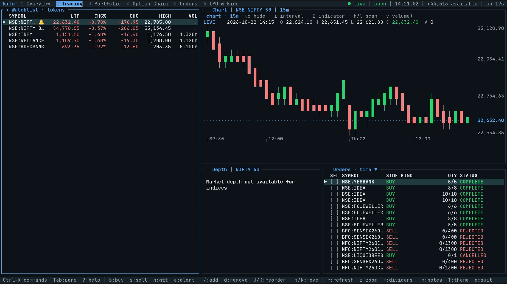
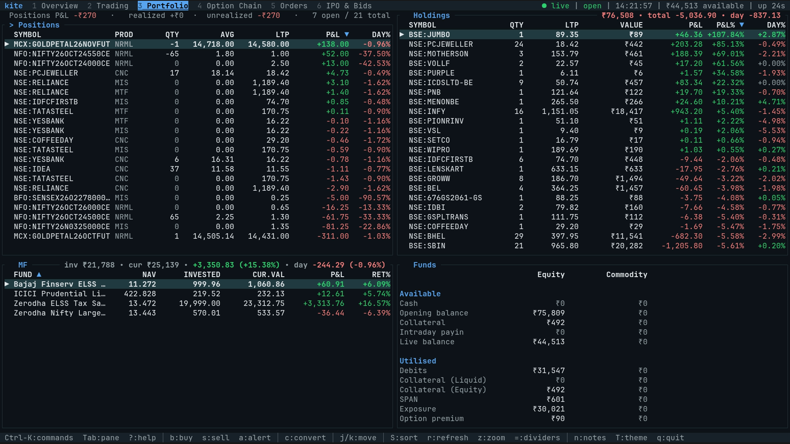
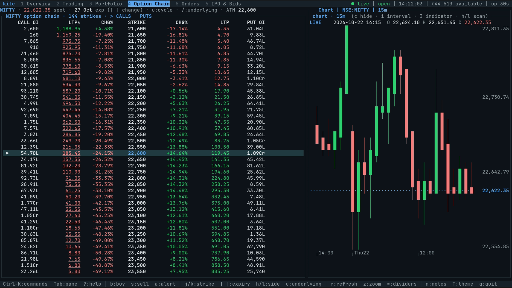
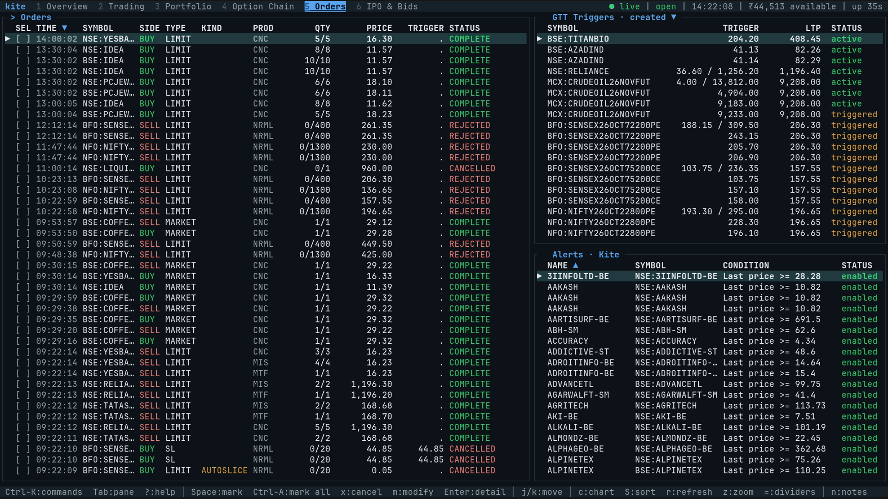
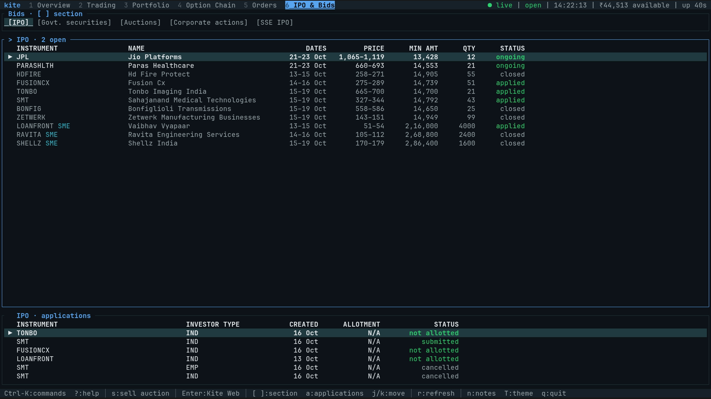
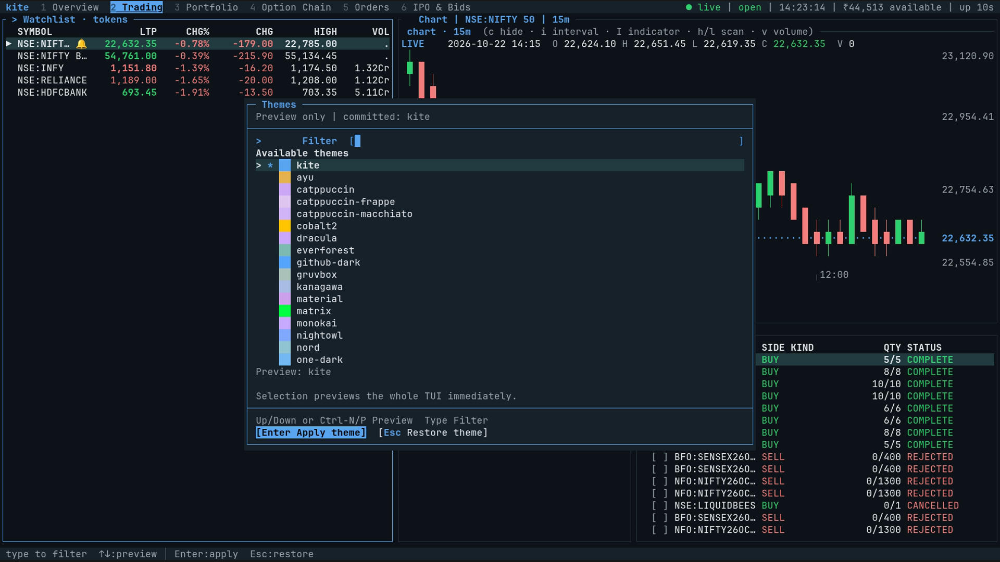

# Screenshots

Full-resolution captures of the Kite terminal UI (`kite`). Select any image to view it at full resolution.

Press `1`–`6` inside the TUI to switch workspaces, or `T` to open the theme picker. See the [Terminal UI guide](guide/tui.md) for all keyboard shortcuts and controls.

[Overview](#1-overview) · [Trading](#2-trading) · [Portfolio](#3-portfolio) · [Option Chain](#4-option-chain) · [Orders](#5-orders) · [IPO & Bids](#6-ipo--bids) · [Themes](#themes)

---

## 1. Overview

Portfolio value, day and overall profit and loss, available funds, open positions and holdings snapshots, tracked indices, and top market movers.

## 2. Trading

Real-time watchlist alongside an interactive candlestick chart, 5-level market depth ladder, and today's order book.

## 3. Portfolio

Open positions, mutual fund holdings, demat and MTF holdings with sortable columns, and a full equity and commodity margin breakdown.

## 4. Option Chain

Live option chain with call/put open interest and expiry selection alongside a chart of the underlying spot instrument.

## 5. Orders

Today's order book, Good Till Triggered (GTT) triggers, and account price alerts (including alert-to-order baskets) in one view.

## 6. IPO & Bids

Open issues and applications across IPOs, government securities, auctions, and corporate actions.

## Themes

Press `T` from any workspace to open the theme picker. Navigate through the 22 built-in themes for an instant live preview, then press `Enter` to apply and save your selection.

---

[Back to main README](../README.md) · [Documentation index](README.md)
